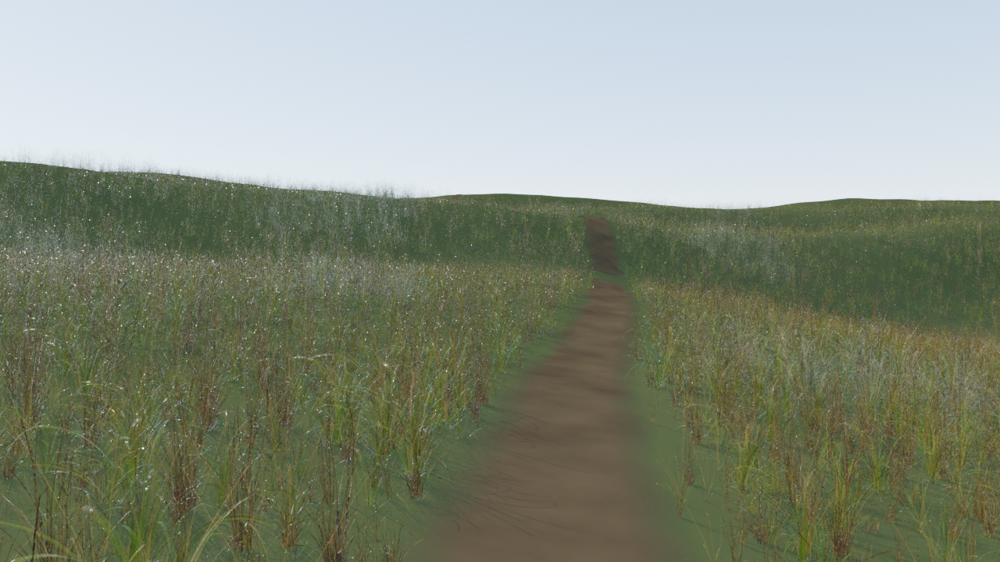
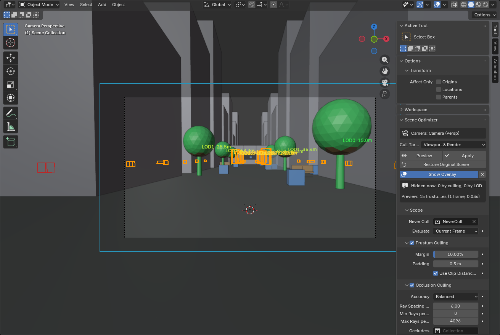
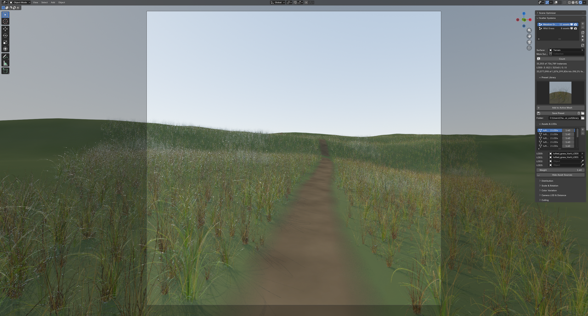
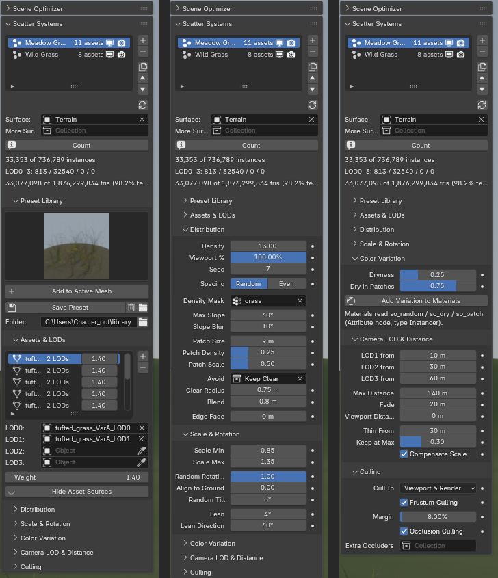
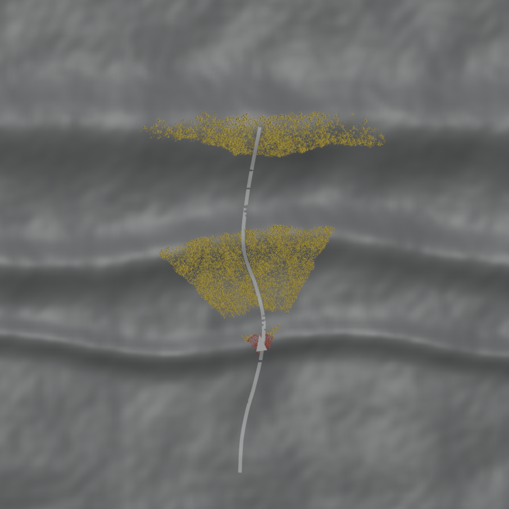
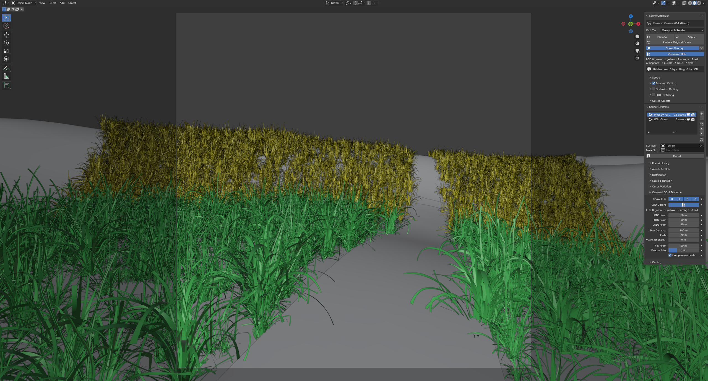
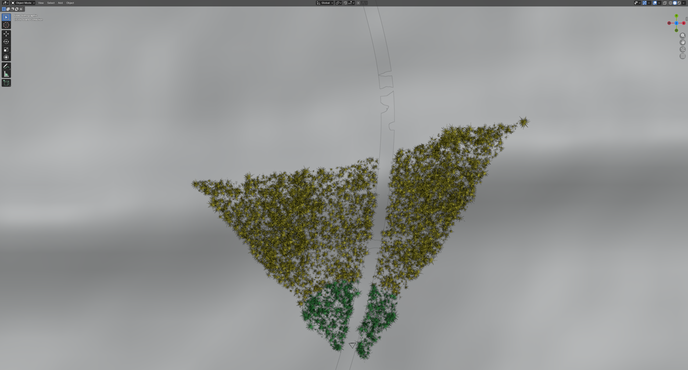
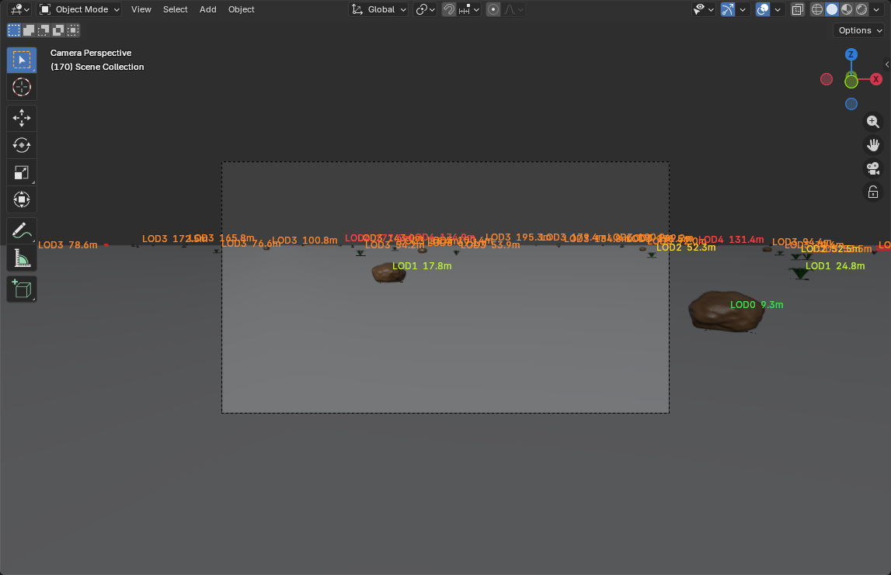

# Scene Optimizer for Blender

Frustum culling, occlusion culling and distance-based LOD switching for large,
realistic environments, plus a complete **grass and foliage scatter tool**, in one
installable `.py` add-on.

* **Scene Optimizer** hides whole objects the camera can't see (outside the frame or behind other
  geometry) and switches LOD models by distance, non-destructively, with preview and one-click
  restore.
* **Scatter Systems** scatter Geometry Nodes instances with masks, noise patches, slope limits,
  paths kept clear, rotation and color variation, and a preset library with thumbnails. Every
  instance is also optimized **individually**: it picks its LOD by camera distance, thins out far
  away, and is removed when it is outside the frame or behind a hill.





| | |
|---|---|
| **Supported Blender** | **4.2 or newer.** Tested on **5.0.0** and **4.5.2 LTS** (Windows). 4.2–4.4 are expected to work but were not tested. |
| **File** | `scene_optimizer.py` (one file, no dependencies besides Blender's bundled numpy) |
| **Location** | 3D Viewport › Sidebar (N) › **Scene Optimizer** tab |
| **Non-destructive** | Only `hide_viewport` / `hide_render` are changed. Geometry, materials, transforms and modifiers are never touched (one explicit, undoable exception: *Align Variants to LOD0*). |

---

## Installation

1. *Edit › Preferences › Add-ons*. In Blender 4.2+, open the **⌄** menu (top right) and choose **Install from Disk…**
2. Select `scene_optimizer.py`. The add-on is enabled automatically. If it isn't, tick **Scene Optimizer**.
3. In the 3D Viewport press **N** and open the **Scene Optimizer** tab.

To update, disable the add-on, install the new file, and enable it again. Disabling the add-on
**restores every object it hid**.

## Quick start

1. Make sure the scene has an active camera (*Scene Properties › Camera*).
2. Tick the systems you want: **Frustum Culling** (on by default), **Occlusion Culling**, **LOD Switching**.
3. Click **Preview**. Nothing in the scene changes. The *Culled Objects* list fills, and the
   viewport overlay draws culled objects' bounds (red = outside frustum, orange = occluded) plus
   LOD labels.
4. Click **Apply** to hide culled objects and switch LODs.
5. Click **Restore Original Scene** at any time to get back exactly what you had.

## Scatter Systems: a grass and foliage scatter tool

Object-level culling can't help a particle or Geometry Nodes scatter: thousands of instances belong
to **one** emitter object. Scatter Systems are a complete scatter tool built around that problem.
You lay out the look (where, how dense, how big, which way, what colour), and every instance is
also optimized **individually, inside Geometry Nodes**, each time Blender evaluates the scene:
in the viewport, on every animation frame, and in renders.





**Workflow**
1. Import your assets as normal objects. For Megascans, use the LOD files: `Grass_VarA_LOD0`,
   `Grass_VarA_LOD1`, and so on.
2. Optional: paint a vertex group on the terrain where the scatter should go (e.g. `grass`).
3. Select the asset objects, then **shift-select the terrain last** so it is active. In the
   **Scatter Systems** panel click **+**. Objects named `*_LOD0`, `*_LOD1` and so on are grouped
   into one asset with those LODs (up to 4 per asset).
4. Add as many systems as you want (dense grass, tall grass, flowers, pebbles). Use
   **Duplicate**, the **up/down** arrows and the per-system **viewport/render** toggles in the
   list. Each system is a holder object (`SO_Scatter_<name>`) with a generated node group.
5. Shape the look in the sub-panels below, then click **Hide Asset Sources**.
6. **Save Preset** to keep the system, or the whole set of systems, in your library for the next
   scene. Click **Count** to see what the system draws now, compared with no optimization.

| Panel | Settings |
|---|---|
| **Scatter Systems** | the list (add, remove, duplicate, reorder, viewport/render toggles, rebuild); **Surface** + **More Surfaces** (a collection of extra ground meshes); **Count** |
| **Preset Library** | thumbnail browser; **Add to Active Mesh**; **Save Preset** (active system, or *All Systems as One Preset*); delete; open folder; library folder |
| **Assets & LODs** | assets with LOD0–LOD3, a **Weight** (relative share of instances) and an **eye** toggle to hide one asset; Hide Asset Sources |
| **Distribution** | Density, Viewport %, Seed; Spacing **Random / Even** (Poisson disk with Min Distance); Density Mask (vertex group); **Max Slope + Slope Blur**; **Patches** (noise size, density, scale) for clumps and bare spots; **Avoid** (a collection of meshes *and curves*, with Clear Radius + Blend: rocks, buildings, footpaths); **Edge Fade** at open mesh borders |
| **Scale & Rotation** | Scale Min/Max; Random Rotation; **Align to Ground** (0 = upright … 1 = follow the normal); Random Tilt; **Lean + Lean Direction** (wind-swept) |
| **Color Variation** | **Dryness** + **Dry in Patches**; **Add Variation to Materials** |
| **Camera LOD & Distance** | **Show LOD0–LOD3** toggles (hide any LOD level); **LOD Colors** (viewport only: LOD0 green, LOD1 yellow, LOD2 orange, LOD3 red); LOD1/2/3 from; **Max Distance + Fade** (a soft band instead of a hard line); **Viewport Distance** (shorter draw distance while you work); **Thin From / Keep at Max / Compensate Scale** |
| **Culling** | **Cull In** (Viewport & Render / Viewport / Render); **Frustum Culling** + Margin; **Occlusion Culling** + Extra Occluders |

**Preset library.** A preset is three files in the library folder (by default Blender's user
`presets/scene_optimizer/scatter`):
* `<name>.json`: the settings and the asset/LOD layout;
* `<name>.blend`: the asset objects with their meshes and materials;
* `<name>.png`: a thumbnail rendered from the LOD0 meshes when you save.

*Add to Active Mesh* appends the assets once per file (adding the preset again reuses them) and
recreates the system(s) on the active mesh. A preset saved with *All Systems as One Preset*
recreates a whole layered setup, such as a meadow of short grass plus tall grass, in one click.

**Color variation.** Every instance carries three attributes:
* `so_random`: 0–1, random per instance;
* `so_dry`: 0–1, set by *Dryness* and *Dry in Patches*;
* `so_patch`: the patch noise.

*Add Variation to Materials* inserts an `SO Instance Variation` node in front of the colour input
of each BSDF in the assets' materials (Principled, Translucent, Diffuse, Subsurface). It reads
those attributes, so each blade gets a small hue and brightness shift, and dry ones turn straw
coloured. You can also read the attributes yourself: *Attribute* node, type *Instancer*.

**How the culling works.** All distances and the frame are measured from the **scene camera**, also
when you look through another view in the viewport. Use *Cull In: Render* to see everything
while you work. Without a scene camera, every instance uses LOD0 and nothing is culled.
* **Frustum.** Each instance is tested in camera space against the frame, with Margin plus the
  instance's own radius as slack. The frame tangents come from `Camera.view_frame`, so lens,
  sensor fit, shift and aspect ratio are all handled. They're synced automatically when any of these
  change. Camera *movement* needs no sync, because the node tree reads the camera's transform
  directly.
* **Occlusion.** One ray per instance, from the **top** of the instance (its asset height × its
  scale) towards the camera, is cast against the surface plus *Extra Occluders*. If it hits, the
  whole instance is below the horizon of a hill and is removed. The test uses only the top point, so
  it never removes an instance whose tip is visible, and the cost is one ray per instance.
* **Shadows and reflections:** a removed instance casts no shadow. Raise *Margin* if shadows
  from off-screen grass matter.
* Orthographic and panoramic cameras turn the frustum test off. Distance LOD and occlusion still
  work.

**Example: real Megascans meadow with two systems.** `examples/megascans_scatter_meadow.py`
builds the meadow above from the three Fab grass assets:
* **Meadow Grass:** 11 Tufted Grass and Grass variations, 13 per m², with noise patches, slight
  tilt and lean, and 25% dry grass in patches.
* **Wild Grass:** 8 variations, 1.2 per m², in looser patches.

Both are masked by a `grass` vertex group on an 800 m terrain. A footpath curve in an *Avoid*
collection keeps a trail clear through both, and the result is saved as one combined preset.

| Frame | Instances drawn (of all) | Triangles drawn (of all at LOD0) |
|---|---|---|
| 1 | 35,356 of 791,218 | 35.0 M of 2,109 M (98.3% fewer) |
| 120 (camera in front of a ridge) | 12,424 of 791,218 | 13.5 M of 2,109 M (99.4% fewer) |
| 240 (camera on the ridge) | 40,514 of 791,218 | 39.8 M of 2,109 M (98.1% fewer) |

The whole build (import, two systems, three frames counted) takes about 20 s, and each
1280×720 EEVEE frame renders in a few seconds.

```
blender -b --python examples/megascans_scatter_meadow.py -- <wild_grass> <grass> <tufted_grass>
        --save meadow.blend --render-dir out/
```



The `*_topdown.png` debug renders colour instances by LOD (red, yellow, blue). They show the
camera wedge, the empty band behind the ridge, the far slope that is visible again over it, and the
footpath.

**Visualize LODs.** One switch in the main panel colours everything by LOD in the viewport
(LOD0 green, LOD1 yellow, LOD2 orange, LOD3 red). The **Show LOD** buttons and each asset's eye
toggle hide any level or asset, so you can inspect it on its own. Renders are never affected.





### How a scatter system is built (for developers)

```
surfaces ─ Distribute (Random | Poisson) ─► points
   │  look:   mask · patches · soft slope · avoid (mesh + curve proximity, inside test) · edge fade
   │  camera: frustum (camera space) · occlusion (1 ray to camera) · distance + fade · thinning
   ▼
Delete ─► Store so_random / so_dry / so_patch ─► per asset × LOD: Instance on Points ─► Join
```

* The node tree is generated in Python (`build_scatter_tree`). Every setting is a group input, so
  changing a slider rewrites one modifier value and never rebuilds the tree.
* Python keeps only what Geometry Nodes can't read in sync: the camera's frame tangents. That
  costs a cheap signature check per depsgraph update.
* Every random decision uses its own seed offset on the point ID. Toggling one feature never
  reshuffles the others, and instances stay put while the camera moves.
* Everything is per point and vectorized by Geometry Nodes, so there is no Python per instance.

---

## Verifying with the test scene

`create_test_scene.py` builds a city street that contains one deliberate case for every behaviour.

1. Install and enable the add-on first, so the script can pre-configure it.
2. Open a **new, empty** file (the script deletes all objects in the current file).
3. *Scripting* workspace › *Text › Open* › `create_test_scene.py` › **Run Script**.
4. In the viewport press **Numpad 0** (camera view), then in the Scene Optimizer tab click **Preview**, then **Apply**.

Expected results (all verified by the automated tests and a GUI run):

| Object | Expected | Why |
|---|---|---|
| `Crate_BehindCamera_*`, `Crate_FarSide_*`, `BenchInstance_03` | **Frustum** culled | outside the view |
| `Crate_BehindBuilding_02…11`, `Crate_BehindWallSolid` (magenta) | **Occluded** | behind buildings / a solid wall |
| `Crate_BehindBuilding_00/01` | Frustum culled | they are also outside the frame |
| `Crate_ThroughWindow` | stays **visible** | only visible through a window opening |
| `Crate_BehindGlass` | stays **visible** | glass (transmission) does not occlude |
| `Crate_PeekingCorner` | stays **visible** | partially visible objects are never culled |
| `Hero_NeverCull` | stays visible | in the *NeverCull* collection (Scope › Never Cull) |
| `Tree_LOD0/1/2[.###]` (12 groups, auto-detected) | exactly **one** variant visible per tree: green LOD0 < 25 m, yellow LOD1 < 60 m, red LOD2 beyond | distance switching |

The report should read `Applied: 15 frustum, 23 occluded of 76 candidates`.

Then try:

* **Live LOD**: enable *LOD Switching › Live Update* and scrub the timeline (the camera flies down
  the street) or move the camera. Trees switch colour and the labels update.
* **Stale culling warning**: after *Apply* at frame 1, scrub to frame 120. The panel warns that
  culling is stale (see `docs/stale_warning.png`). Set *Scope › Evaluate* to **Frame Range** and
  Apply again: every object seen at any sampled frame is kept (`15 frustum, 12 occluded … 25 frames`).
* **Render**: render the animation. Each frame renders exactly one LOD per tree.
* **Restore Original Scene**: everything returns, including objects you had hidden yourself before.

## Example: Quixel Megascans LODs

[`examples/quixel_lod_example.py`](examples/quixel_lod_example.py) turns Megascans 3D assets into a
working LOD scene in one step.



**What it does**

1. Imports **every LOD** of each asset. Supported layouts:
   - a Bridge folder with one file per LOD (`<id>_LOD0.fbx … <id>_LOD5.fbx`);
   - a Fab `.zip` (extracted automatically next to the zip);
   - one file holding all LODs (`…_LOD0 … _LOD5` objects);
   - **plant variations** (`Var1_LOD0 … Var2_LOD3`).

   `*_High.fbx` (the multi-million-triangle source mesh) is skipped. FBX, OBJ, glTF and Alembic are supported.
2. Builds a PBR material from the Megascans textures: Albedo, Roughness, Normal (using the
   **per-LOD normal maps** `_Normal_LOD<n>` when present) and Opacity → Alpha for plants. It prefers 2K
   textures (`TEXTURE_RESOLUTION`). If no textures are found, the imported materials are kept.
3. Scatters **linked copies** (meshes are shared, not duplicated) across a field in front of a
   camera, from 2 m out to past the last LOD distance. Each copy is an empty with one child per
   LOD, so Scene Optimizer's *Auto-Detect* pairs them by parent.
4. Creates one LOD group per copy, with switch distances **scaled to each asset's size**: LOD1 at
   12 × the asset's radius, then doubling per level (`LOD1_DISTANCE_FACTOR`).
5. Applies LODs and frustum culling over the whole animated fly-through (*Frame Range*), turns on
   *Live Update*, and prints/stores a report in the Text Editor ("Megascans LOD Example - report"):
   ```
   Groups by state at frame 1: LOD0 93, LOD1 49, LOD2 26, LOD3 53, LOD4 6, LOD5 3, culled 10
   Triangles: all LOD0 = 454,400  ->  rendered now = 199,408  (56.1% fewer)
   ```
   These numbers come from the low-poly stand-in assets. Real Megascans LOD0s are often 20k–200k
   triangles, so the savings are much larger.

It builds into a **new scene** ("Megascans LOD Example") and leaves your other scenes untouched.

**Run it**

* **Inside Blender:** *Scripting* › *Text › Open* › `quixel_lod_example.py`, put your asset
  folder(s) or zip(s) in `ASSET_PATHS` at the top, then **Run Script**. Press Numpad 0 and scrub the timeline.
* **Command line:**
  ```bash
  blender --python examples/quixel_lod_example.py -- "C:/…/Megascans Library/Downloaded/3d/rock_sandstone_xxxx" "C:/…/plant_fern_xxxx.zip" --copies 80 --save megascans_lod.blend
  ```
  Options: `--copies N` (per variation), `--seed N`, `--save file.blend`, `--render preview.png`.

**Getting assets:** on Fab, download a Megascans 3D asset or 3D plant in **FBX** format with **all
LODs** included, and pass the `.zip`. From Bridge, export to a local folder and pass the asset's
folder under `Downloaded/3d/` or `Downloaded/3dplant/`. If you imported assets yourself (e.g. with
the Bridge/Fab Blender plugin, all LODs), you don't need this script: select them and use
*LOD Switching › Auto-Detect Groups*.

**Testing status:** no real Megascans files were available when this was written, so the
example was validated against **stand-in assets that reproduce the Megascans layout and naming**
(`tests/make_fake_megascans.py`): a 6-LOD rock with per-LOD normal maps and a Fab-style plant zip
with two variations. `tests/test_quixel_example.py` checks, on Blender 5.0 and 4.5, that:
- every copy shows exactly one LOD, and the level its own distance calls for;
- scrubbing switches LODs;
- copies share mesh data;
- the materials have loaded textures, including per-LOD normals and fern alpha;
- your original scene is untouched.

If a real download uses a naming pattern the script doesn't recognise, it prints what it found per
file. The variation name comes from the object name with the `LOD<n>` token removed.

### Real-asset example: Megascans grass meadow (object LOD groups)

*For grass, the Scatter Systems above are the recommended workflow. This older example builds
the same meadow out of ordinary objects: 4 m patches, each one an LOD group. It shows the
object-level systems on real data.*


`examples/megascans_grass_meadow.py` builds a rolling meadow from three free Fab grass assets
(Wild Grass, Grass and Tufted Grass, using the "high" FBX zips) and sets it up the way a game engine draws grass:

* grass is grouped into **4 m patches** (150 real clumps each, merged). Each patch is one LOD
  group:
  * **LOD0** (under 10 m): the full Megascans LOD0 clumps;
  * **LOD1** (10–30 m): the Megascans LOD1 meshes;
  * **LOD2** (over 30 m): 30% of the clumps at their lowest mesh LOD, scaled up to thin out the density;
  * beyond 140 m the patch is hidden and the ground shader carries the colour.
* **frustum culling** hides patches outside the frame;
* **occlusion culling** hides patches behind the ridges. Only the terrain occludes
  (*Occluders* = `Terrain`), and grass never blocks rays.

```
blender -b --python examples/megascans_grass_meadow.py -- <wild_grass zip/folder> <grass ...> <tufted_grass ...>
        --save meadow.blend --render-dir out/
```

Results with the three assets (3,060 patches, 9,180 objects, Blender 5.0):

| Frame | LOD0 / LOD1 / LOD2 | Frustum / behind hills / too far | Triangles all-LOD0 → drawn | Culling time |
|---|---|---|---|---|
| 1 | 12 / 47 / 775 | 1,120 / 27 / 1,079 | 1,316,708,552 → 47,029,636 (96.4% fewer) | 1.1 s |
| 120 | 13 / 46 / 715 | 1,452 / 84 / 750 | 1,316,708,552 → 44,422,010 (96.6% fewer) | 1.7 s |
| 240 | 14 / 42 / 792 | 1,767 / 5 / 440 | 1,316,708,552 → 47,768,742 (96.4% fewer) | 1.7 s |

`--render-dir` writes an EEVEE frame plus a top-down debug view (`*_topdown.png`) for each of
these frames. The debug view colours patches by LOD (red, yellow, blue) and leaves out every culled patch,
so the frustum wedge and the gaps behind the ridges are visible.

Notes on real Fab grass downloads:
* The LOD level comes from the **file name** (`*_VarA_LOD1.fbx`). The object names inside these
  files don't match it (`*_LOD1.fbx` contains `…_VarA_LOD2`).
* The last LOD of every variation is a single-card **billboard** for engines that turn it towards
  the camera. Seen edge-on in Blender it disappears, so the script skips it.

---

## The three systems

### 1. Frustum culling

**How it works:** Every object's world-space oriented bounding box (8 corners) is tested against
the camera's frustum planes, built from `Camera.view_frame()`. That means sensor fit, aspect ratio,
lens shift, perspective and orthographic cameras are all handled by Blender's own math. An object is
culled only if **all 8 corners are outside the same plane**. This test is *conservative*: it never
culls a visible object, though it may keep a few invisible ones near frustum corners. The tests are
vectorised with numpy.

| Setting | Meaning |
|---|---|
| Margin (%) | Expands the frame by this percentage of its width/height **on each side**. Use it to keep objects that are just off-screen (camera shake, motion blur, reflections at the frame edge). |
| Padding (m) | Keeps objects whose bounds are within this world distance of the frustum. |
| Use Clip Distances | Also culls objects entirely beyond *Clip End* or in front of *Clip Start*. |

### 2. Occlusion culling

**Chosen method: ray casting against a merged world-space BVH** (`mathutils.bvhtree`).

1. All relevant geometry (evaluated, with modifiers, collection instances, optionally
   particle/geometry-nodes instances) is merged into one BVH, with a lookup table that maps each triangle to its owner.
2. For every object still inside the frustum, its bounding box is projected to the screen, and
   rays are cast from the camera through a grid of points covering that screen rectangle,
   at **render resolution**.
3. The object is **visible as soon as one ray's first opaque hit is the object itself.** It is
   occluded only if no ray reaches it. Rays start at *Clip Start* and end at *Clip End*, so
   clipped geometry never occludes.
4. Rays pass **through** non-blocking geometry (transparent materials, objects flagged *Not an
   Occluder*, inactive LOD variants) and keep going.
5. Geometry that can never block a ray (non-occluders, objects outside the *Occluders*
   collection, transparent foliage) is represented in the BVH by its **bounding box** (12
   triangles) instead of its mesh. This is still conservative: any ray that reaches the real
   geometry has entered the box earlier, with no blocker in between. It is what makes dense
   foliage practical: for the grass meadow below, the BVH holds the terrain plus one box per
   patch instead of more than 1 billion grass triangles.

Why this approach: it works for arbitrary geometry (buildings, terrain, walls with openings,
interiors), and the error mode is controllable. Blender's Python API offers no GPU depth/ID
read-back that would work reliably in background mode and inside the depsgraph, and
`scene.ray_cast()` cannot tell you which collection instance was hit.

**Safety rules (anything uncertain is kept visible):**
* An object whose bounds cross the near plane, or that surrounds the camera, is kept.
* An object with no triangles (volumes, point clouds, hair curves, empties) is kept.
* An object that is only partly inside the ray region (e.g. inside *Padding*) is kept.
* With frustum culling **off**, off-screen objects are not occlusion-culled.
* If a ray crosses more than *Max Pass-Through* transparent layers, the object is kept.

| Setting | Meaning |
|---|---|
| Accuracy | Presets: Fast (12 px), Balanced (6 px), Accurate (2 px) |
| Ray Spacing (px) | Distance between rays at render resolution. **Smaller gaps than this can be missed.** |
| Min Rays per Axis | Minimum grid across each object, which protects small or distant objects |
| Max Rays per Object | Budget. If exceeded, spacing grows for that object and you get a warning when such an object ends up culled. |
| Occluders | Optional collection: only these objects block rays (e.g. *Buildings*, *Terrain*) |
| Transparent Materials Don't Occlude | Glass / alpha / transmission / blended materials let rays through (on by default) |
| Particle/GN Instances Occlude | Off by default (foliage has holes). Collection instances always occlude. |
| Max Triangles | Occlusion is skipped with a warning if the BVH would exceed this |

**Limitations of the method, stated plainly:**
* **It is sampling-based, not exact.** A visible sliver narrower than *Ray Spacing* (for example a
  pole seen through a 1-pixel gap) can be missed, and that object would be wrongly culled. The test
  suite confirms that a 13 px slit is found at Balanced, and that the same slit is missed at
  100 px spacing. For final renders use **Accurate** or a 1–2 px custom spacing.
* **It is valid for one camera position** (or for every sampled frame in *Frame Range* mode). Between
  sampled frames, or after the camera moves, results can be wrong. The panel warns when the camera
  has moved since *Apply*.
* **The transparency check is a heuristic.** It inspects Principled Alpha/Transmission, Glass,
  Transparent and Refraction nodes (including inside node groups), *Blended* render method and
  viewport alpha. Unusual setups (an alpha driven by an attribute through a custom shader, a
  holdout, a backface-culled material) may not be detected. Mark such objects **Not an Occluder**.
* **Shadows, reflections and GI:** a culled object no longer casts shadows or appears in
  reflections. That is the nature of culling. Raise *Margin*, use *Never Cull*, or use
  *Cull Target: Viewport* when this matters for final frames.
* Displacement done only at render time (Cycles adaptive subdivision) is not in the evaluated
  viewport mesh.

### 3. Distance-based LOD switching

**Model:** An *LOD group* is an ordered list of separate objects (LOD0 = most detailed). Switching
toggles visibility so exactly one variant is visible. LOD always switches **both** viewport and
render visibility, whatever the *Cull Target*, so variants can never render together. Each
variant keeps its own mesh, materials and modifiers. Nothing is swapped or moved. This matches how
FBX/game assets arrive (`SM_Rock_LOD0`, `SM_Rock_LOD1`, …), usually under a common parent.

**Distance:** measured from the active camera to LOD0's bounds (*Bounds Center*, *Nearest
Bounds* (best for large buildings) or *Origin*). LOD*n* becomes active at distance threshold *n*. Optional:
* **Max Draw Distance** hides the whole group beyond a distance.
* **Hysteresis** (live mode) keeps a ±% band around thresholds so LODs don't flicker.
* **Focal Length Compensation** scales distance by FOV relative to a 50 mm lens, so telephoto
  shots keep detail.
* **Lock Level** forces one level per group.
* **Max LOD Labels** limits overlay labels to the N nearest groups in front of the camera (default 40).

**Setting up many assets at once:**
* **Auto-Detect Groups** scans a collection (or the selection) for names ending in `LOD<n>`
  (`_LOD1`, `.lod1`, `-LOD 1`, …). Variants are grouped by common parent, or by Blender's duplicate
  suffix (`Tree_LOD0.001` pairs with `Tree_LOD1.001`), so hundreds of scattered copies become
  hundreds of groups in one click. Re-running never duplicates groups.
* **Group from Selected (+)** creates one group from the selection, ordered by LOD number in the
  names, or otherwise by polygon count (most polygons = LOD0).
* Groups use the scene's **Default Distances** unless *Custom Distances* is ticked, and
  **Defaults for All** resets every group.
* **Align Variants to LOD0** (explicit, undoable) snaps variants that were imported side by side.

**Update modes:**
* **Update** button: evaluates once.
* **Live Update**: a depsgraph handler compares a camera signature (matrix, lens, sensor, type) and
  checks whether any LOD object moved. Only then does it schedule a debounced (50 ms) timer that
  re-evaluates. Nothing runs while the camera is still.
* **Update on Frame Change** (with Live): switches synchronously on frame change, so playback and
  **animation renders** get the right LOD on every frame. This was verified by rendering three Cycles
  frames on both Blender versions: each frame shows exactly one pure-colour variant. For renders
  started from the UI, enabling *Render › Lock Interface* is recommended, as for any add-on that
  changes data during rendering.

**LOD limitations:**
* Variants are assumed to share one placement (same transform, or the same parent at the same
  offset). If they don't, use *Align Variants to LOD0*.
* Blender stops updating `matrix_world` of objects hidden with *Disable in Viewports*. The add-on
  rebuilds LOD0's matrix from its parent chain, which is tested with a moving parent. If LOD0
  *itself* is animated or constrained while hidden, the visible variant's transform is used
  instead.
* An object can belong to only one group; a conflicting group is skipped with a warning.
* Max 8 levels per group.

---

## How culling, LOD and restore work together

```
            ┌─────────────── Visibility manager ───────────────┐
Frustum ──┐ │ per object: ID property "_scene_optimizer_state" │
Occlusion ┼─► reasons = {FRUSTUM, OCCLUSION, LOD, DISTANCE}    ├──► hide_viewport / hide_render
LOD ──────┘ │ originals hv0/hr0 · last written hv1/hr1         │
            └──────────────────────────────────────────────────┘
```

* **One writer.** Only the visibility manager ever writes `hide_viewport` / `hide_render`. Each
  system adds or removes *reasons*. An object is hidden while it has any reason, and returns to its
  **original** state when the last reason is removed. The systems therefore never fight. For
  example, *Restore › Culling* un-culls objects while LOD keeps only one variant visible.
* **Originals are stored on the object** (an underscore-prefixed custom property), not in memory.
  Restore works after save/reload, renames and undo.
* **Manual edits are respected.** If you change an object's visibility while it is culled, your
  value becomes the new original, so Restore won't undo your edit.
* **Never un-hides your hidden objects.** Objects you had hidden are not culling candidates, and
  their state is never changed.
* **Evaluation from a clean state.** Hidden objects drop out of Blender's depsgraph, so *Preview*
  and *Apply* temporarily restore everything, evaluate, then re-apply. Re-applying therefore gives
  stable results instead of flip-flopping. *Preview* puts the exact previous state back.
* **Culling units.** All instances generated by an object (collection instance, particles,
  geometry-nodes instances) are judged together with their instancer, using the instances' real
  bounds. LOD variants form one unit, so co-located variants never occlude each other and are culled
  together.

### Edge cases handled

| Situation | Behaviour |
|---|---|
| No active camera / active camera isn't a Camera | Clear error, nothing changes |
| Panoramic camera | Culling refused with an explanation (no pyramid frustum). LOD still works. |
| Linked (library) objects | Skipped and counted in a warning (they're read-only). Instancer empties you own are culled normally. |
| Animated or driven `hide_viewport` / `hide_render` | Skipped (the animation would overwrite changes). Layered actions in 4.4+/5.x are supported. |
| Lights, cameras, empties without instances | Never culled. Lights still light the scene. |
| Metaballs | Not culled (hiding one element changes the whole metaball), but still occlude |
| Geometry-nodes object that outputs only instances | Bounds come from the instances, not from the empty base mesh. Regression-tested. |
| Deleted variants / objects not in this scene | Ignored; the panel shows "variant(s) missing" |
| Errors mid-run | Scene state is rolled back to the snapshot, then the error is reported |
| Disabling the add-on | Restores everything it hid |

### Performance and trade-offs

Measured on Blender 5.0, Windows, single thread (`tests/benchmark.py`):

| Scene | Time |
|---|---|
| 10,040 objects, frustum only (5,077 culled) | 1.2 s |
| … + occlusion, 1.57 M triangles, Fast / Balanced / Accurate | 4.2 s / 4.6 s / 6.5 s |
| 1,681 objects + occlusion (test suite) | 0.55 s |
| Live LOD update, 1,000 groups | ~50 ms (only when the camera or an LOD object moves) |

* **No per-frame work by default.** Culling runs only when you press Preview/Apply. LOD runs only
  on demand, or with *Live Update* when something actually moved.
* **Visibility writes are batched.** Setting `hide_viewport` through Python makes Blender re-sync
  all collections on *every* write, which is O(n²) for thousands of objects. The add-on queues
  writes and flushes them with one `foreach_set` plus a single update trigger (a test verifies the
  depsgraph afterwards). In the 10k-object benchmark this halved Apply time.
* **Occlusion cost** is dominated by building the BVH (it scales with triangle count, mitigated by
  skipping geometry outside the frustum) and by rays for objects that turn out to be occluded
  (visible objects exit early). Use an *Occluders* collection with only large, simple geometry
  (buildings, walls, terrain) to make it much faster.
* **Frame Range** multiplies cost by the number of sampled frames. *Static Geometry* builds the BVH
  once and is much faster for camera fly-throughs, but must not be used when objects move.
* **Culling is object-level.** `hide_viewport` is a property of the object, so an object
  linked into several scenes is hidden in all of them.
* It works on the active view layer's depsgraph. Objects hidden by the eye icon or by excluded
  collections are treated as already invisible.

### Game-engine workflows

Culled objects are disabled, so exporters that have a "Visible Objects only" option (FBX, glTF)
skip them. LOD groups follow the common `_LOD<n>` naming that Unreal and Unity import as LOD
chains. Note that runtime engines perform their own culling: in that context this add-on is mainly
useful for **previewing** what a camera sees, for trimming geometry from a fixed-camera export, and
for viewport and render performance inside Blender.

---

## UI reference

* **Main panel:** camera status · Cull Target (Viewport & Render / Viewport / Render) · **Preview** ·
  **Apply** · **Restore Original Scene** · overlay toggle · **Visualize LODs** · a live count of
  objects hidden by culling and by LOD · last report · stale-camera warning.
* **Visualize LODs:** one switch that colours everything by LOD level in the viewport: the
  variants of every LOD group and every scatter system (LOD0 green, LOD1 yellow, LOD2 orange,
  LOD3 red, then magenta, purple, blue, cyan; the overlay labels use the same colours). Objects get a
  viewport-only *SO LOD Colors* modifier, so renders and mesh data are never touched, and
  switching off removes it. Works in Solid (Color: Material), Material Preview and Rendered
  shading. Scatter systems also have their own *LOD Colors* checkbox.
* **Scope:** Never Cull collection, Evaluate (Current Frame / Frame Range + Step + Static Geometry),
  and active-object flags **Never Cull** and **Not an Occluder**, plus why it is hidden.
* **Frustum Culling / Occlusion Culling / LOD Switching:** each with an enable checkbox in its header.
* **Culled Objects:** a filterable list with reasons. *Select* works after Preview, while objects
  are still visible.
* **Overlay:** red = outside frustum, orange = occluded, cyan = camera frustum including margin,
  and coloured `LOD<n>  <distance>` labels.
* **Scatter Systems** (own panel in the same tab): the systems list and Count, then the
  sub-panels *Preset Library*, *Assets & LODs*, *Distribution*, *Scale & Rotation*,
  *Color Variation*, *Camera LOD & Distance* and *Culling*. See
  [Scatter Systems](#scatter-systems-a-grass-and-foliage-scatter-tool).

## Tests

```bash
blender -b --factory-startup --python tests/run_tests.py -- scene_optimizer.py
```
```bash
blender -b --factory-startup --python tests/render_test.py -- scene_optimizer.py
```
```bash
blender -b --factory-startup --python tests/benchmark.py -- scene_optimizer.py
```

* `run_tests.py`: 28 tests (frustum incl. ortho and shift, margins, clip, never-cull/exclude,
  pre-hidden objects, cull targets, manual edits, save/reload/rename, preview leaves the scene
  untouched, animated/driven/linked skipping, occlusion: walls, windows, peeking, glass, flags,
  occluder collection, collection instances, a camera inside a room, a narrow slit, GN instances, batched
  depsgraph writes, LOD switching, custom, lock, hysteresis, max distance, a hidden LOD0 with a
  moving parent, auto-detect, LOD × occlusion integration, the frame-change handler, frame range,
  unregister restore, operators, performance). Passing on 5.0.0 and 4.5.2.
* `test_scatter.py`: Scatter Systems. It checks:
  * a system is created from a selection, with LOD-name grouping;
  * every instance shows the LOD its distance calls for;
  * no instance falls outside the frustum or behind the camera;
  * no kept instance is hidden behind a ridge, the valley behind it is empty, and the far slope
    visible over the ridge stays populated;
  * max distance, thinning, the Cull-In modes and each culling toggle work;
  * a lens change re-syncs the frustum;
  * hidden asset sources are still instanced;
  * Count works and restores settings;
  * several systems can coexist, and removing one cleans up.

  Passing on 5.0.0 and 4.5.2:
  ```bash
  blender -b --factory-startup --python tests/test_scatter.py
  ```
* `test_scatter_tools.py`: the scatter tool's features. It checks:
  * with no camera everything is LOD0 and nothing is culled;
  * Extra Surfaces are scattered, a 70° wall is skipped by Max Slope, and Slope Blur thins a
    slope near the limit;
  * Even spacing keeps Min Distance (Random doesn't);
  * patches create dense and sparse areas;
  * a curve path and a rock (including the ground under it) are kept clear, and grass resumes
    next to them;
  * Edge Fade thins the border;
  * rotation: none, lean towards a heading, random tilt, Align to Ground 0 and 1 on a slope;
  * `so_random` / `so_dry` / `so_patch` are on every instance, Dryness sets the dry share, and
    the variation node is wired into materials only once;
  * Viewport Distance and Fade;
  * duplicate, reorder and the viewport/render toggles;
  * presets: save writes `.json` / `.blend` / `.png`, the browser lists them, adding appends the
    assets with materials and restores settings, re-adding reuses assets, combined presets add
    every system, and delete removes the files.

  Passing on 5.0.0 and 4.5.2:
  ```bash
  blender -b --factory-startup --python tests/test_scatter_tools.py
  ```
* `render_test.py`: renders 3 Cycles frames of an animated camera and checks pixel colours to
  prove LOD switching during animation renders.
* `gui_test.py`: interactive smoke test (panels, overlay, live LOD timer, screenshots).
* `make_fake_megascans.py` + `test_quixel_example.py`: build stand-in Megascans assets, then
  validate `examples/quixel_lod_example.py` against them:
  ```bash
  blender -b --factory-startup --python tests/make_fake_megascans.py -- fake_ms
  ```
  ```bash
  blender -b --factory-startup --python tests/test_quixel_example.py -- fake_ms
  ```
